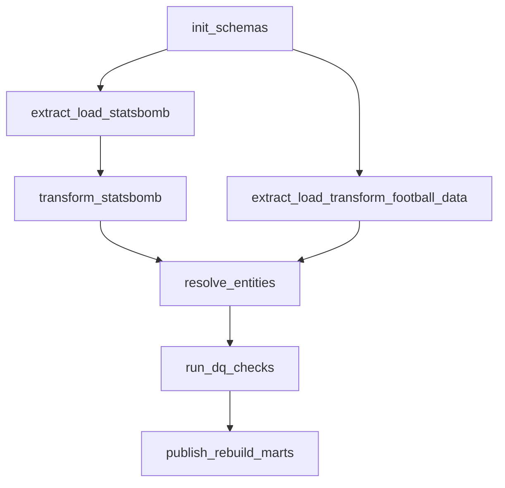

# Football Data Quality & ETL Platform

Local pipeline for StatsBomb / football-data.org load, data quality, and football metrics.

## Status

### Phase 1

Vertical slice for StatsBomb World Cup 2022 final (`match_id=3869685`):

1. raw ingest
2. staging / core
3. five DQ checks
4. box entries, progressive passes, shot possessions
5. box entry pitch map

### Phase 2

Full StatsBomb WC 2022 tournament in `DQ_MODE=observe`:

- 64 matches through raw → staging → core
- DQ on every match
- marts rebuild for all `PUBLISHABLE` matches
- profiles for event volumes, coordinates, and types without location

### Phase 3

Second provider football-data.org for WC 2022 (`DQ_MODE=observe`):

- raw / staging ingest (live API or bootstrap fixtures if historical WC is 403 on free tier)
- manual team seed: 32 national teams × 2 providers
- match mapping by competition + season + canonical home/away + kickoff confirm
- score normalization (canonical without penalties; final `3:3` / pens `4:2`)
- cross-source DQ: arithmetic, score, kickoff, mapping coverage — all PASS on 64/64

### Phase 4

Publication gate (`DQ_MODE=enforce` for phase4; default `.env` stays `observe`):

- expanded match DQ + `config/checks.yml` registry
- reconcile `match_publication_status` after match + cross-source checks
- global CRITICAL gate stops marts rebuild
- marts only for `PUBLISHABLE`; match CRITICAL → `QUARANTINED`
- corrupted fixtures + pytest; CLI `--demo-quarantine` shows 1 quarantined / 64 publishable

### Phase 5

Airflow 3.0.2 LocalExecutor on the same Postgres (`football` + `airflow` DBs):

- DAG `football_data_pipeline` wraps CLI via [`src/orchestration.py`](src/orchestration.py)
- extract tasks: `retries=3`; StatsBomb ∥ football-data after `init`
- UI: http://localhost:8080 (SimpleAuth all-admins for local)
- CLI remains the primary path; compose does not auto-run the pipeline



## Specs

- [docs/data_contract.md](docs/data_contract.md)
- [docs/metrics.md](docs/metrics.md)
- [docs/dq_rules.md](docs/dq_rules.md)

## How to run

```bash
cp .env.example .env
# set FOOTBALL_DATA_ORG_API_KEY
# keep AIRFLOW_UID=50000 on macOS (host UID breaks the Airflow image)

docker compose up -d
# first Airflow image build may take a few minutes
python3 -m venv .venv
source .venv/bin/activate
pip install -r requirements.txt
```

Phase 5 (Airflow):

```bash
docker compose up -d
# UI http://localhost:8080 — SimpleAuth all-admins (local)
# Trigger DAG football_data_pipeline from UI, or:
TOKEN=$(curl -sS -X POST http://localhost:8080/auth/token \
  -H 'Content-Type: application/json' \
  -d '{"username":"admin","password":"admin"}' | python3 -c 'import sys,json;print(json.load(sys.stdin)["access_token"])')
curl -sS -X PATCH -H "Authorization: Bearer $TOKEN" -H 'Content-Type: application/json' \
  -d '{"is_paused":false}' http://localhost:8080/api/v2/dags/football_data_pipeline
curl -sS -X POST -H "Authorization: Bearer $TOKEN" -H 'Content-Type: application/json' \
  -d '{"logical_date":"2022-11-20T12:00:00Z"}' \
  http://localhost:8080/api/v2/dags/football_data_pipeline/dagRuns
```

One match:

```bash
python -m src.pipeline run --match-id 3869685
```

Full tournament (StatsBomb):

```bash
DQ_MODE=observe python -m src.pipeline run --competition WC2022
python -m src.pipeline profile --competition WC2022
```

Phase 3 (football-data + cross-source), after StatsBomb WC2022 is in core:

```bash
python -m src.pipeline phase3 --competition WC2022
# or step by step:
python -m src.pipeline ingest-football-data --competition WC2022
python -m src.pipeline seed-teams
python -m src.pipeline resolve-matches --competition WC2022
python -m src.pipeline dq-cross --competition WC2022
pytest tests/test_score_normalization.py -q
```

Phase 4 (publication / enforce):

```bash
python -m src.pipeline phase4 --competition WC2022
python -m src.pipeline phase4 --competition WC2022 --demo-quarantine
pytest tests/test_quality.py tests/test_score_normalization.py -q
```

Step by step (StatsBomb):

```bash
python -m src.pipeline init
python -m src.pipeline ingest --competition WC2022
python -m src.pipeline build --competition WC2022
python -m src.pipeline dq --competition WC2022
python -m src.pipeline marts
python -m src.pipeline viz --match-id 3869685
python -m src.pipeline profile --competition WC2022
```

Artifacts:

- map: `artifacts/box_entries_3869685.png`
- profiles: `artifacts/profiles/`
- bootstrap fixtures (if API 403): `data/football_data/wc2022_*.json`
- team seed: `seeds/team_source_mapping.csv`
- DQ registry: `config/checks.yml`
- quality fixtures: `tests/fixtures/valid|corrupted/`
- Airflow DAG: `dags/football_pipeline.py`
- DAG diagram: `docs/airflow_dag.png`
