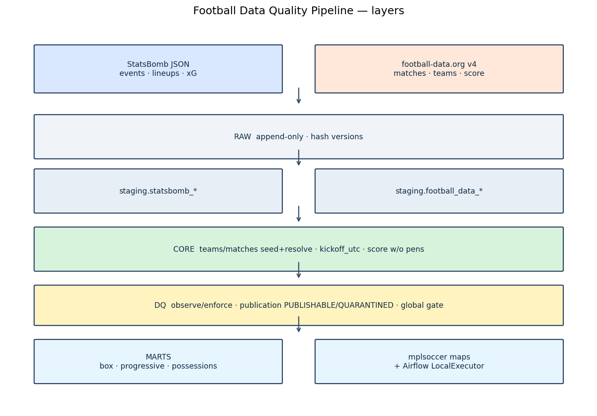
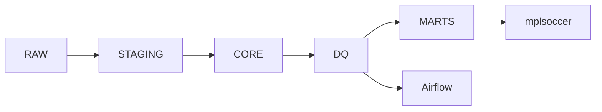
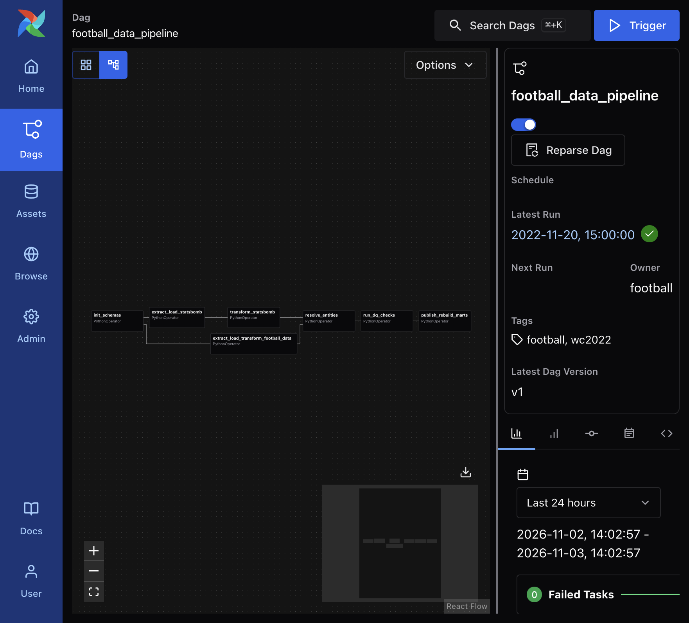
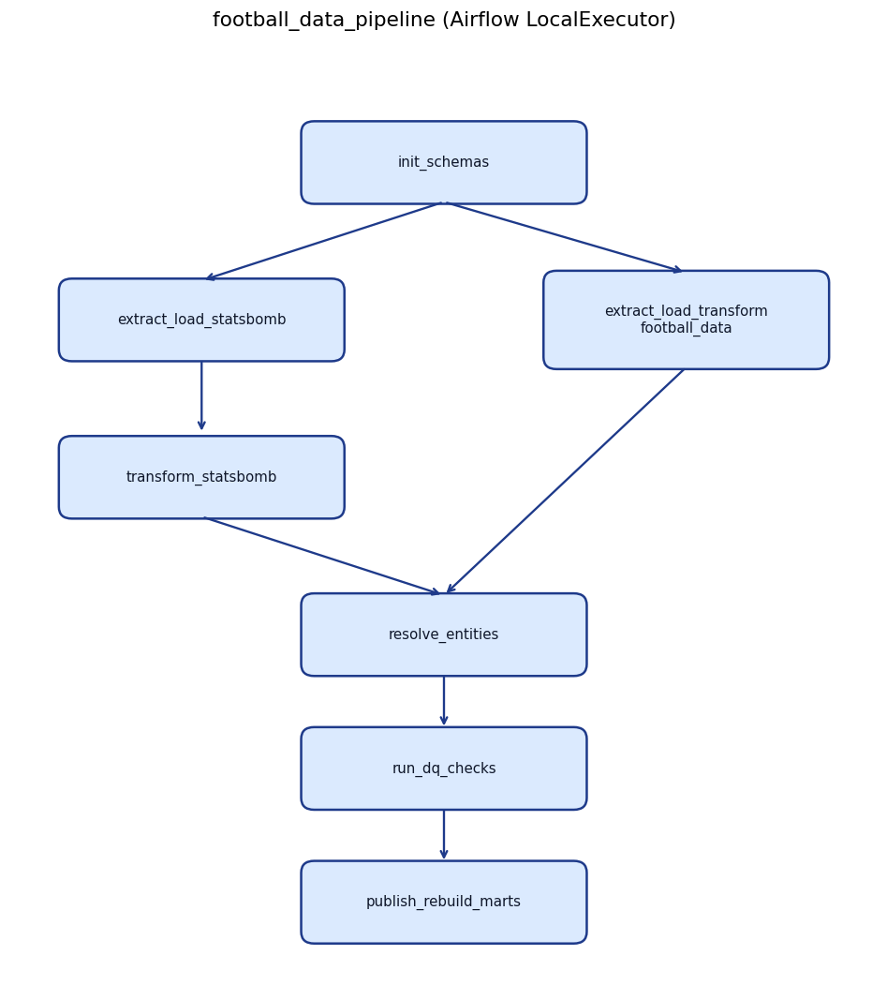
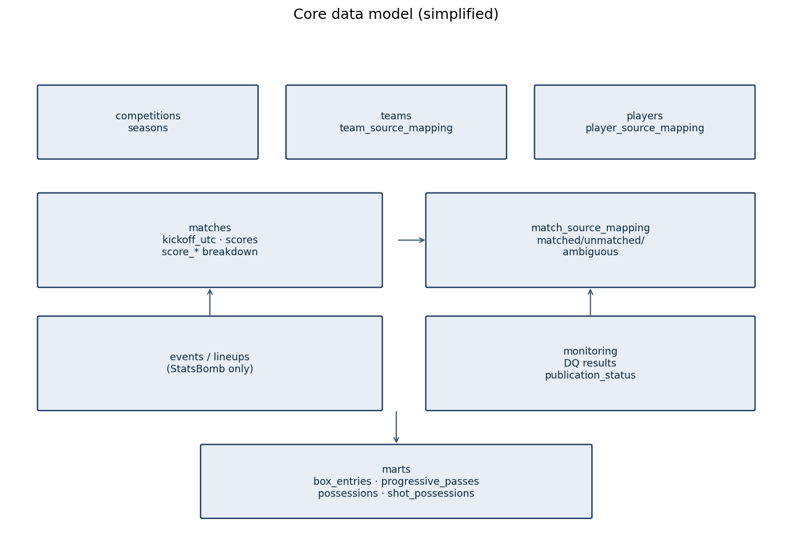
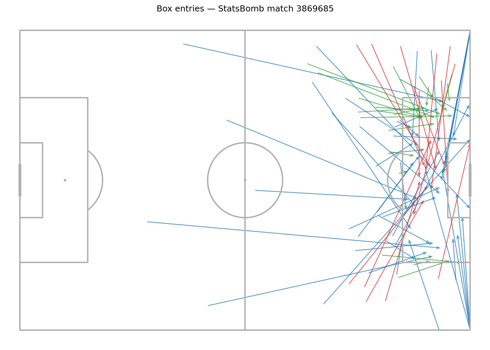
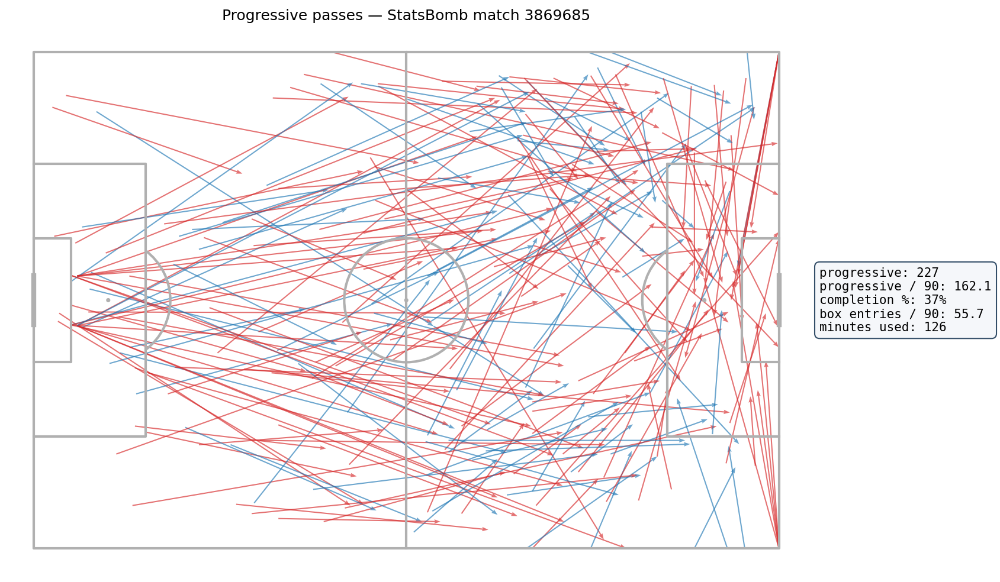
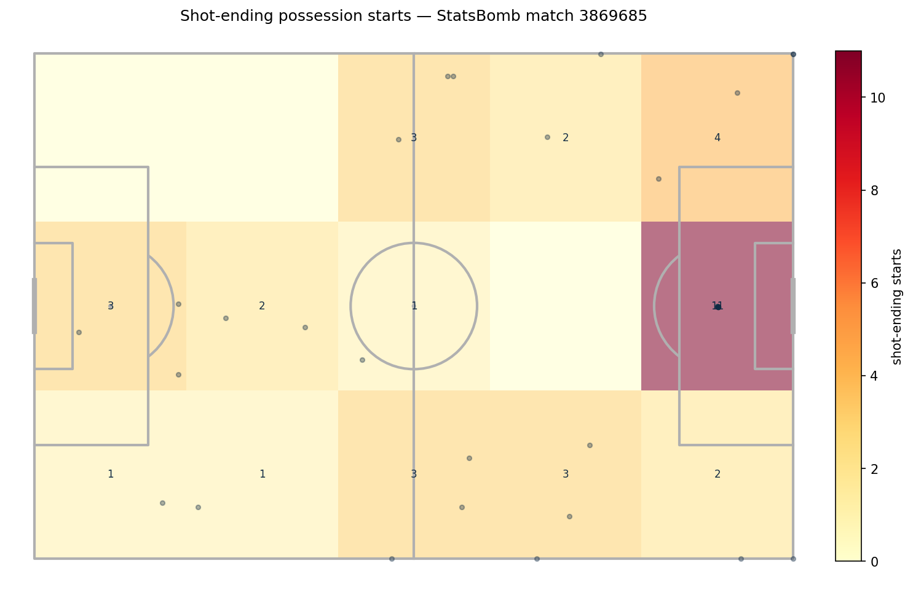

# Football Data Quality & ETL Platform

Local pipeline for StatsBomb / football-data.org load, data quality, football metrics, and pitch maps.





## Status

### Phase 1–2

StatsBomb WC 2022: vertical slice on the final (`3869685`), then full 64-match tournament in `DQ_MODE=observe` with profiles.

### Phase 3

football-data.org WC 2022: seed teams, match mapping, score normalization (final `3:3` / pens `4:2`), cross-source DQ PASS 64/64.

### Phase 4

Publication gate: global CRITICAL, match quarantine in `enforce`, marts only for `PUBLISHABLE`.

### Phase 5

Airflow 3.0.2 LocalExecutor (`football_data_pipeline`) wrapping the same CLI. UI: http://localhost:8080.





### Phase 6

Delivery / presentation (no Superset — outside MVP):

- three mplsoccer maps for the final
- architecture + data-model diagrams
- progressive-pass definition notebook (`notebooks/metric_validation.ipynb`)
- README visualizations



## Specs

- [docs/data_contract.md](docs/data_contract.md)
- [docs/metrics.md](docs/metrics.md)
- [docs/dq_rules.md](docs/dq_rules.md)
- [docs/airflow.md](docs/airflow.md)

## Visualizations

Final WC 2022 (`match_id=3869685`), PUBLISHABLE marts only:

| Map | File |
|---|---|
| Box entries | [docs/viz/box_entries_3869685.png](docs/viz/box_entries_3869685.png) |
| Progressive passes (+ /90 panel) | [docs/viz/progressive_passes_3869685.png](docs/viz/progressive_passes_3869685.png) |
| Shot-ending possession starts (zones) | [docs/viz/zone_heatmap_3869685.png](docs/viz/zone_heatmap_3869685.png) |







```bash
python -m src.pipeline viz --match-id 3869685 --map all
# --map box|progressive|heatmap|all
```

## How to run

```bash
cp .env.example .env
# set FOOTBALL_DATA_ORG_API_KEY
# keep AIRFLOW_UID=50000 on macOS

docker compose up -d
python3 -m venv .venv
source .venv/bin/activate
pip install -r requirements.txt
```

One match:

```bash
python -m src.pipeline run --match-id 3869685
```

Full tournament (StatsBomb):

```bash
DQ_MODE=observe python -m src.pipeline run --competition WC2022
python -m src.pipeline profile --competition WC2022
```

Phase 3 (football-data + cross-source):

```bash
python -m src.pipeline phase3 --competition WC2022
pytest tests/test_score_normalization.py -q
```

Phase 4 (publication / enforce):

```bash
python -m src.pipeline phase4 --competition WC2022
python -m src.pipeline phase4 --competition WC2022 --demo-quarantine
pytest tests/test_quality.py tests/test_score_normalization.py -q
```

Phase 5 (Airflow):

```bash
docker compose up -d
# UI http://localhost:8080 — SimpleAuth all-admins (local)
TOKEN=$(curl -sS -X POST http://localhost:8080/auth/token \
  -H 'Content-Type: application/json' \
  -d '{"username":"admin","password":"admin"}' | python3 -c 'import sys,json;print(json.load(sys.stdin)["access_token"])')
curl -sS -X PATCH -H "Authorization: Bearer $TOKEN" -H 'Content-Type: application/json' \
  -d '{"is_paused":false}' http://localhost:8080/api/v2/dags/football_data_pipeline
curl -sS -X POST -H "Authorization: Bearer $TOKEN" -H 'Content-Type: application/json' \
  -d '{"logical_date":"2022-11-20T12:00:00Z"}' \
  http://localhost:8080/api/v2/dags/football_data_pipeline/dagRuns
```

Phase 6 (maps):

```bash
python -m src.pipeline marts
python -m src.pipeline viz --match-id 3869685 --map all
```

Step by step (StatsBomb):

```bash
python -m src.pipeline init
python -m src.pipeline ingest --competition WC2022
python -m src.pipeline build --competition WC2022
python -m src.pipeline dq --competition WC2022
python -m src.pipeline marts
python -m src.pipeline viz --match-id 3869685 --map all
python -m src.pipeline profile --competition WC2022
```

## Artifacts

- maps: `artifacts/{box_entries,progressive_passes,zone_heatmap}_3869685.png`
- docs maps: `docs/viz/`
- diagrams: `docs/architecture.png`, `docs/data_model.png`, `docs/airflow_dag.png`, `docs/airflow_ui.png`
- profiles: `artifacts/profiles/`
- bootstrap fixtures: `data/football_data/wc2022_*.json`
- team seed: `seeds/team_source_mapping.csv`
- DQ registry: `config/checks.yml`
- Airflow DAG: `dags/football_pipeline.py`

## Limitations

- Players and events exist only from StatsBomb (no cross-provider player mapping).
- Default `DQ_MODE=observe`; `phase4` runs enforce explicitly.
- Superset is out of MVP scope.
- Progressive-pass completion % uses Pass `pass_outcome` joins; shown as N/A if events cannot be matched.
